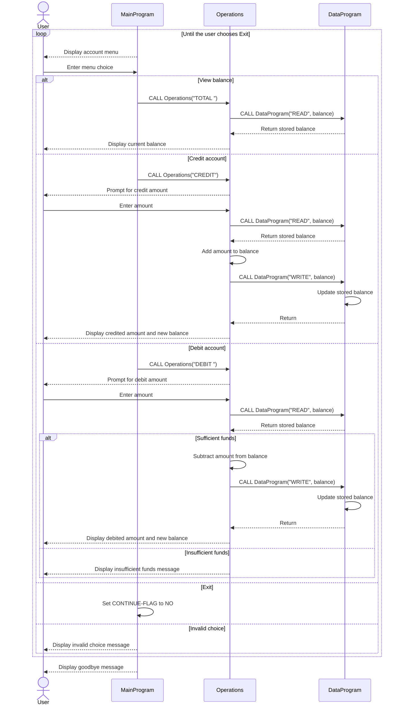

# COBOL Account Management

This directory documents the COBOL account management example in `src/cobol/`.
The program provides a console menu to view a balance, credit an account, or
debit an account.

## Source Files

### `main.cob` - `MainProgram`

Displays the menu and reads the user's choice. It dispatches balance, credit,
and debit requests to `Operations`, and exits when the user selects option 4.
Choices outside 1-4 display an error and return to the menu.

### `operations.cob` - `Operations`

Implements the account actions requested by `MainProgram`:

- `TOTAL `: reads and displays the current balance.
- `CREDIT`: accepts an amount, reads the balance, adds the amount, and saves
  the result.
- `DEBIT `: accepts an amount, reads the balance, and saves the reduced
  balance only when sufficient funds are available.

### `data.cob` - `DataProgram`

Owns the stored balance and handles `READ` and `WRITE` operations passed by
`Operations`. The balance is initialized to `1000.00` and is held in working
storage, so it is in memory only and resets when the program starts again.

## Student Account Business Rules

- The example starts with one account balance of `1000.00`.
- A credit increases the balance by the entered amount.
- A debit is allowed only when the current balance is greater than or equal to
  the debit amount; otherwise, the balance is unchanged and an insufficient
  funds message is displayed. The rules do not allow overdrafts.
- Amount fields use an unsigned numeric format with two implied decimal places.
  The program does not define additional amount validation or error handling.
- Although this example may be used to explore student-account workflows, it
  does not store student identifiers, maintain separate balances per student,
  or persist account data between runs.

## Call Flow

`MainProgram` calls `Operations` with an action code. `Operations` calls
`DataProgram` to read or write the balance; user input and result messages are
handled in `Operations` and `MainProgram`.

## Sequence Diagram

